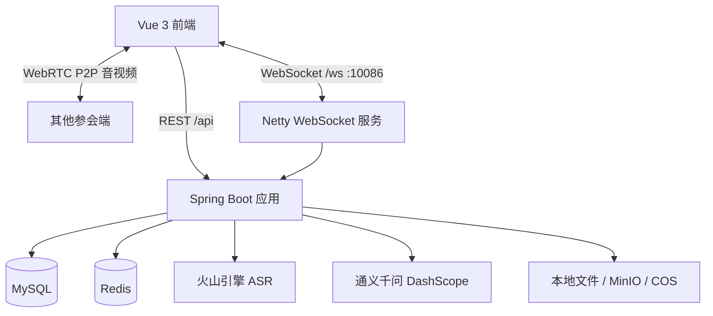

# 会联（HuiLian）

会联是一个面向在线会议与团队协作的一体化平台，提供高清视频会议、实时语音转写、多语种字幕翻译、会议纪要生成，以及好友私聊、群聊和管理后台等能力。

前端基于 Vue 3 + WebRTC，后端基于 Spring Boot + Netty，音视频采用 P2P 直连，服务端只负责信令转发、消息分发和业务数据持久化。

## 功能特性

### 会议
- 即时会议与预约会议，支持会议号、入会密码、等候室和参会人数限制
- 麦克风、摄像头开关，屏幕共享，参会成员管理与主持人控制
- 会议内文字聊天、成员进出提示
- 会议结束后自动触发 AI 总结

### 实时语音与 AI
- 基于火山引擎流式 ASR 的实时语音识别
- 基于通义千问的实时多语种字幕翻译
- 会议结束后生成结构化纪要：概览、关键要点、决议事项、待办事项、关键词
- 长会议采用分段提炼再合并的 Map-Reduce 策略，避免上下文超限

### 即时通讯
- 好友申请、好友列表、私聊
- 群聊创建、群号搜索、入群审批
- 群主/成员邀请好友入群，成员邀请需群主审核
- 图片、文件消息，未读数、会话置顶、最后已读位点
- 管理端可封禁群聊，群主可提交申诉，管理员审核解封

### 管理后台
- 数据概览：用户、会议、群聊等统计
- 会议管理：查看会议列表、会议纪要，删除会议
- 用户管理：查看用户、启用/禁用账号
- 群聊管理：查看群聊、进入群聊、封禁/解封
- 群聊申诉：查看申诉并审核

## 技术栈

### 后端
| 技术 | 说明 |
| --- | --- |
| Java 17 | 开发语言 |
| Spring Boot 2.4.5 | Web 与业务容器 |
| MyBatis-Plus 3.5.2 | ORM、分页、逻辑删除 |
| MySQL 8 | 业务数据持久化 |
| Redis | 会议主持人映射、在线状态等缓存 |
| Netty 4.1 | WebSocket 长连接、信令与消息推送 |
| JWT + BCrypt | 登录鉴权与密码加密 |
| WebRTC | 浏览器端 P2P 音视频与屏幕共享 |
| Knife4j / Swagger | 接口文档（默认关闭） |
| 火山引擎 ASR SDK | 实时语音识别 |
| DashScope（通义千问） | 实时翻译与会议总结 |
| 本地存储 / MinIO / 腾讯 COS | 文件存储抽象 |

### 前端
| 技术 | 说明 |
| --- | --- |
| Vue 3 | 组合式 API |
| Vite 5 | 开发与构建 |
| Naive UI | 组件库 |
| Pinia | 状态管理 |
| Vue Router 4 | 路由与权限守卫 |
| Axios | HTTP 请求封装 |
| WebRTC + WebSocket | 音视频通话与信令 |
| Sass | 样式 |

## 系统架构



### 分层结构
- Controller：REST 接口，统一返回 `ApiResponse`
- Service：业务编排，事务控制
- Mapper：MyBatis-Plus 数据访问
- Netty：WebSocket 连接管理、信令与消息广播
- Interceptor：JWT 登录校验、管理员权限校验

### 两条核心链路

**1. 音视频通话**

浏览器之间通过 WebRTC 建立 P2P 连接，Netty WebSocket 只转发 SDP、ICE Candidate 等信令。会议房间、在线用户与主持人信息由内存和 Redis 共同维护。

**2. 实时转写与翻译**

浏览器采集麦克风音频并通过 WebSocket 上报，后端转发至火山引擎流式 ASR。定稿语句写入逐字稿表，再调用通义千问完成翻译和总结，结果通过 WebSocket 广播给参会端。

## 目录结构

```text
.
├── src/main/java/cn/cxdproject/coder
│   ├── controller        # REST 控制器
│   ├── service           # 业务服务与 AI 服务
│   ├── mapper            # MyBatis-Plus Mapper
│   ├── model             # 实体、DTO、VO
│   ├── config            # Web、Redis、Netty、CORS 等配置
│   ├── interceptor       # 登录与管理员权限拦截器
│   ├── websockt          # Netty WebSocket、信令处理
│   └── common            # 通用返回、上下文、存储、异常
├── src/main/resources
│   ├── mapper            # MyBatis XML
│   ├── db/migration      # 增量数据库迁移脚本
│   └── application.yml   # 主配置
├── web
│   ├── src/api           # 接口封装
│   ├── src/views         # 前台与管理端页面
│   ├── src/store         # Pinia 状态
│   ├── src/router        # 路由与权限守卫
│   └── src/composables   # WebRTC、WebSocket 等组合式逻辑
├── sql/schema.sql        # 统一数据库结构（无初始化数据）
└── pom.xml
```

## 快速开始

### 环境要求
- JDK 17
- Maven 3.8+
- Node.js 18+
- MySQL 8
- Redis 6+

### 1. 初始化数据库
```bash
mysql -uroot -p < sql/schema.sql
```

### 2. 配置后端
在 `src/main/resources/` 下创建本地 `application-dev.yml`，配置 MySQL、Redis 等连接信息。该文件不纳入版本控制。

```yaml
spring:
  datasource:
    url: jdbc:mysql://localhost:3306/tengxunmeeting?useUnicode=true&characterEncoding=utf8&serverTimezone=Asia/Shanghai
    username: your_username
    password: your_password
  redis:
    host: localhost
    port: 6379
    password:
```

也可以通过环境变量覆盖，例如 `SERVER_PORT`、`MEETING_NETTY_PORT`、`JWT_SECRET`。

### 3. 启动后端
```bash
mvn spring-boot:run
```
- REST 服务：`http://localhost:8080`
- WebSocket：`ws://localhost:10086/ws`

### 4. 启动前端
```bash
cd web
npm install
npm run dev
```
- 前台：`http://localhost:3000`
- 管理端：`http://localhost:3000/admin`

管理端仅允许 `ADMIN` 或 `SUPER_ADMIN` 角色访问。将对应用户的 `meeting_user.role` 设置为 `ADMIN` 后，登录即可看到「管理后台」入口。

## 可选配置

AI 与语音识别能力默认开启，但需要配置对应密钥才会真正调用：

| 环境变量 | 说明 |
| --- | --- |
| `MEETING_AI_ENABLED` | 是否启用翻译与总结 |
| `DASHSCOPE_API_KEY` | 通义千问 API Key |
| `VOLCENGINE_ASR_APP_ID` | 火山引擎 ASR App ID |
| `VOLCENGINE_ASR_ACCESS_KEY` | 火山引擎 ASR Access Key |
| `VOLCENGINE_ASR_SECRET_KEY` | 火山引擎 ASR Secret Key |
| `FILE_STORAGE_TYPE` | `local`、`minio` 或 `cos` |

文件默认存储在项目根目录的 `app_uploads`，通过 `/api/files/**` 提供访问。

## 数据库

统一结构脚本位于 [`sql/schema.sql`](sql/schema.sql)，仅包含表结构，不包含初始化数据。`src/main/resources/db/migration` 保留历史增量迁移脚本，便于追溯字段变更。
